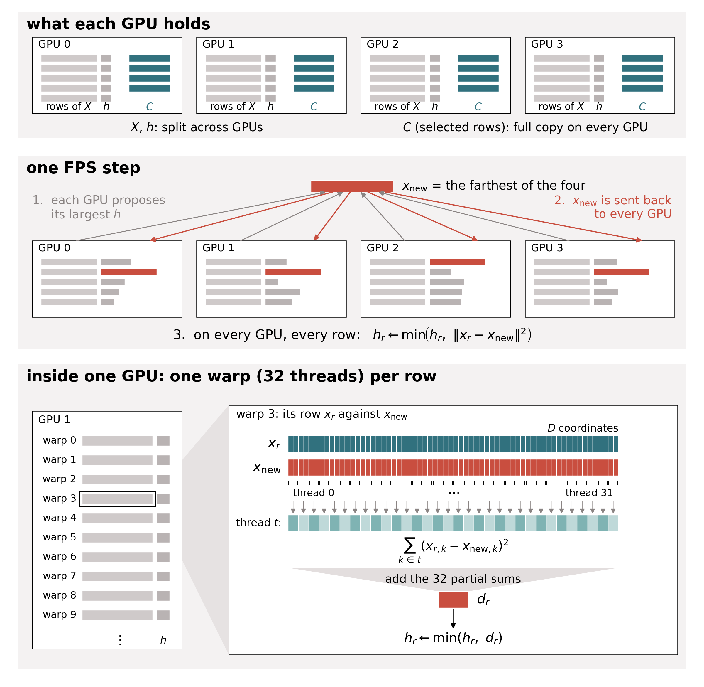

# coresets

Farthest point sampling (FPS) on GPUs for feature matrices with hundreds of
millions of rows, plus a way to merge new data into an existing FPS ordering.



Each GPU holds its own rows of `X`, the distance `h` of each row to the
nearest selected row, and a full copy of the selected rows `C`. One FPS step
picks the row with the largest `h` across all GPUs, sends it to every GPU, and
every row lowers its `h` if the new row is closer. Inside a GPU one warp
computes one row's distance.

## Install

```bash
git clone https://github.com/sofiia-chorna/coresets.git
pip install -e coresets
```

Needs Python 3.10 or newer, torch and numpy. The CUDA kernels compile on first
use, which needs `nvcc` and takes about a minute. `pip install coresets`
installs an unrelated package from PyPI, so install from the clone.

## Three ways to run FPS

Input is a float32 matrix `X` with one row per point. Output is the row indices
of the selected points, in selection order.

**python** runs anywhere, no compile, fine up to a few million rows.

```python
from coresets import fps

selected, epsilons, hausdorff, voronoi = fps(X, k)
```

**cuda** runs on one GPU with custom kernels, for tens of millions of rows.

```python
from coresets import fps_cuda

selected = fps_cuda(X.cuda(), k)
```

**sharded** runs on many GPUs. Each rank loads its own slice of `X` and calls
the same function. Launch with `torchrun` or `srun`.

```python
import torch.distributed as dist
from coresets import compute_shard_layout, fps_sharded

dist.init_process_group("nccl")
rank = dist.get_rank()
sizes, offsets = compute_shard_layout(n_rows, dist.get_world_size())
X_local = load_rows(offsets[rank], offsets[rank] + sizes[rank]).cuda()

selected, epsilons = fps_sharded(X_local, k)
```

All three give the same `selected`. `selected[:m]` is the FPS answer for any
smaller `m`. `epsilons[i]` is the squared radius of the first `i` picks.

## Merging new data into an ordering

`accrete` takes an anchor set with its FPS ordering and a pool of new
candidates. It returns one ordering over both where the first `2 ** k` entries
form a valid coreset at every level and keep as much of the anchor as the new
data allows. `accrete_sharded` is the many GPU version.

```python
from coresets import accrete

coreset = accrete(X_anchor, X_candidates, anchor_order, max_k=14)
```

Entries below `len(X_anchor)` come from the anchor.

## Saving results

```python
from coresets import save_result, load_result

save_result("results/run1", selected, epsilons=epsilons, n_rows=n_rows, dim=dim)
result = load_result("results/run1")
```

This writes `selected.npy`, `epsilons.npy` and `meta.json` into one directory.
`meta.json` records the sizes, the backend, the git commit and every
`CORESETS_*` variable that was set.

## Examples

```bash
python examples/fps_example.py --demo 20000 64 --k 512 --out results/demo
python examples/fps_example.py --features X.npy --k 10000 --out results/run1 --backend cuda
torchrun --nproc_per_node=4 examples/fps_example.py --features X.npy --k 10000 --out results/run1 --backend sharded
python examples/accrete_example.py single
```

On CSCS Clariden use the Slurm template, which runs the sharded version on 4 GPUs.

```bash
sbatch examples/submit_example.sh fps --features X.npy --k 10000 --out results/run1
sbatch examples/submit_example.sh accrete
```

## Speed settings

Production accretion runs set `CORESETS_FILL_CHUNK=256 CORESETS_BISECT_SEED=1`.
With nothing set every run gives the same picks as before. The other
`CORESETS_*` variables are read in `src/coresets/cuda/multi/_base.py`.

## Tests

```bash
pytest
sbatch tests/slurm/test_determinism.sh
```
